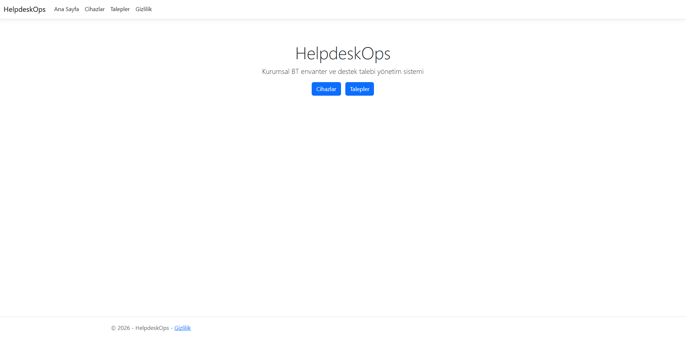
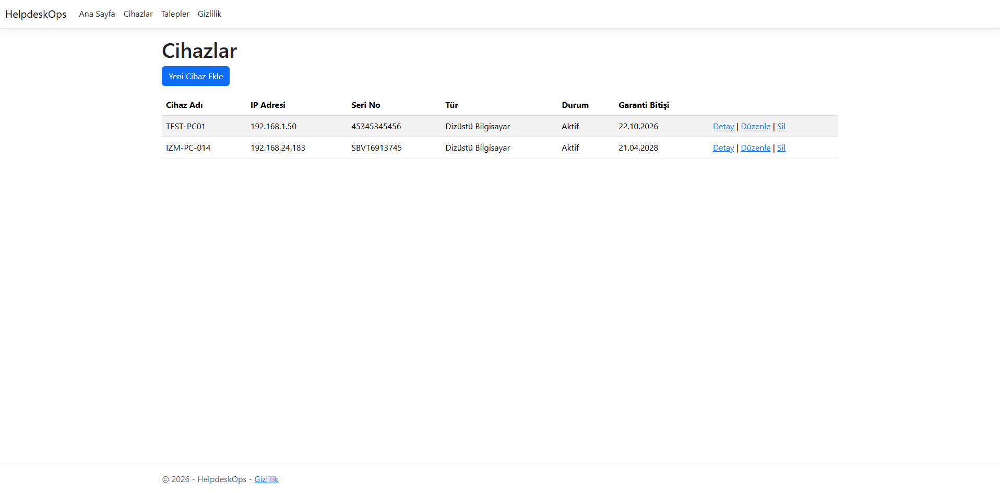
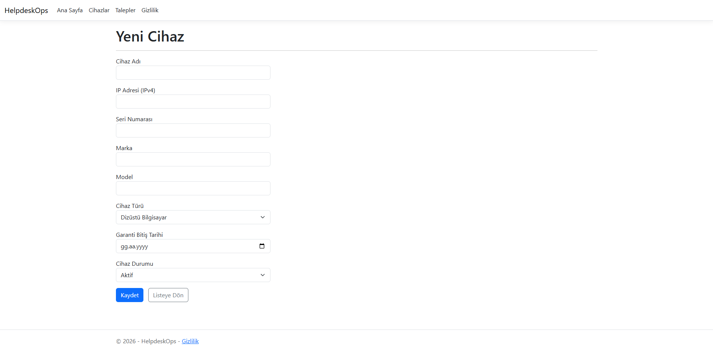
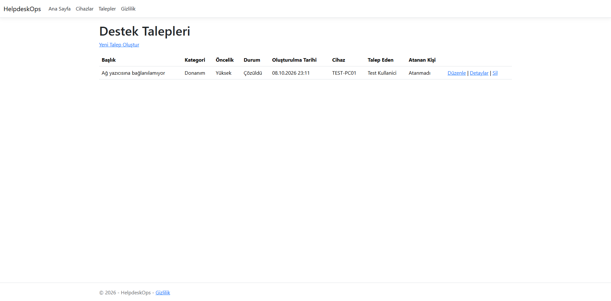
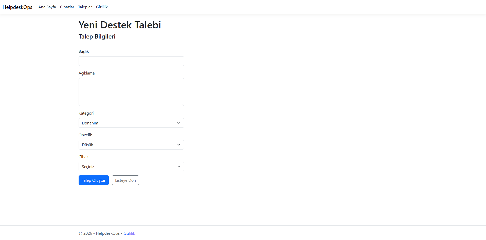
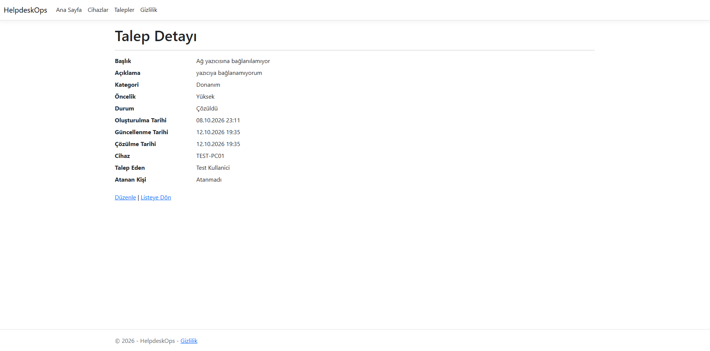

# HelpdeskOps Kullanım Kılavuzu

HelpdeskOps, kurumsal bir BT ortamında cihaz envanterini ve destek taleplerini tek bir arayüzden yönetmek için geliştirilmiş bir ASP.NET Core (.NET 10) web uygulamasıdır. Bu kılavuz, uygulamanın mevcut sürümündeki ekranları ve işlemleri açıklar. Kurulum adımları için [README.tr.md](../README.tr.md) dosyasına bakınız.

## İçindekiler

1. [Ana Sayfa](#1-ana-sayfa)
2. [Cihaz Yönetimi](#2-cihaz-yönetimi)
3. [Destek Talebi Yönetimi](#3-destek-talebi-yönetimi)
4. [Mevcut Sürümün Kapsamı](#4-mevcut-sürümün-kapsamı)

## 1. Ana Sayfa

Ana Sayfa, uygulamanın iki ana modülüne (Cihazlar ve Talepler) kısayol sağlar. Aynı bağlantılar sayfanın üst menüsünde de bulunur.

## 2. Cihaz Yönetimi

### 2.1 Cihazları Listeleme

**Cihazlar** menüsü, kayıtlı tüm cihazları cihaz adı, IP adresi, seri numarası, tür, durum ve garanti bitiş tarihi ile listeler. Her satırdaki **Detay**, **Düzenle** ve **Sil** bağlantıları ilgili cihaz üzerinde işlem yapmayı sağlar.

### 2.2 Yeni Cihaz Ekleme

Cihazlar sayfasındaki **Yeni Cihaz Ekle** düğmesi, cihaz kayıt formunu açar.

| Alan | Açıklama |
|---|---|
| Cihaz Adı | Cihazın ağdaki adı (hostname). Zorunlu alandır. |
| IP Adresi (IPv4) | Cihazın IPv4 adresi. Geçerli bir IPv4 biçiminde girilmelidir. |
| Seri Numarası | Üretici tarafından verilen seri numarası. |
| Marka / Model | Cihazın markası ve modeli. |
| Cihaz Türü | Listeden seçilir (ör. Dizüstü Bilgisayar). |
| Garanti Bitiş Tarihi | Garanti süresinin sona erdiği tarih. |
| Cihaz Durumu | Cihazın mevcut durumu (ör. Aktif). Yeni cihazlarda varsayılan değer Aktif'tir. |

**Kaydet** düğmesi kaydı oluşturur, **Listeye Dön** düğmesi kaydetmeden listeye döner. Oluşturulma ve güncellenme tarihleri sistem tarafından otomatik atanır.

## 3. Destek Talebi Yönetimi

### 3.1 Talepleri Listeleme

**Talepler** menüsü, destek taleplerini başlık, kategori, öncelik, durum, oluşturulma tarihi, ilişkili cihaz, talep eden ve atanan kişi bilgileriyle listeler. Tarihler kullanıcının yerel saat dilimine göre gösterilir.

### 3.2 Yeni Talep Oluşturma

**Yeni Talep Oluştur** bağlantısı talep formunu açar.

| Alan | Açıklama |
|---|---|
| Başlık | Sorunun kısa özeti. |
| Açıklama | Sorunun ayrıntılı tanımı. |
| Kategori | Talebin kategorisi (ör. Donanım). |
| Öncelik | Talebin aciliyet düzeyi (ör. Düşük, Yüksek). |
| Cihaz | Talebin ilişkili olduğu envanter kaydı. Seçilmesi isteğe bağlıdır. |

Talebin oluşturulma tarihi, durumu ve talep eden bilgisi form üzerinden girilmez, sistem tarafından atanır.

### 3.3 Talep Ayrıntıları ve Durum Takibi

Listedeki **Detaylar** bağlantısı, talebin tüm bilgilerini gösterir.

Talebin durumu **Düzenle** ekranından güncellenir. Kullanılabilir durumlar:

| Durum | Anlamı |
|---|---|
| Açık | Talep alındı, henüz işleme başlanmadı. |
| İşlemde | Talep üzerinde çalışılıyor. |
| Çözüldü | Sorun giderildi. |
| Kapatıldı | Talep sonlandırıldı. |

Durum **Çözüldü** ya da **Kapatıldı** olarak kaydedildiğinde **Çözülme Tarihi** sistem tarafından otomatik olarak yazılır. Talep daha sonra **Açık** veya **İşlemde** durumuna geri alınırsa Çözülme Tarihi temizlenir. Çözüldü durumundan Kapatıldı durumuna geçişte ilk çözülme tarihi korunur.

## 4. Mevcut Sürümün Kapsamı

Bu kılavuz, uygulamanın geliştirme aşamasındaki sürümünü anlatır. Aşağıdaki özellikler henüz uygulanmamıştır:

- Kullanıcı girişi ve rol tabanlı yetkilendirme. Talepler şu an geçici bir test kullanıcısı adına açılır.
- Taleplerin bir BT personeline arayüzden atanması.
- Panolar ve raporlar.

Planlanan geliştirmelerin tamamı için [README.tr](../README.tr.md) dosyasındaki yol haritasına bakınız.
