# HelpdeskOps Kullanım Kılavuzu

HelpdeskOps, kurumsal bir BT ortamında cihaz envanterini ve destek taleplerini tek bir arayüzden yönetmek için geliştirilmiş bir ASP.NET Core (.NET 10) web uygulamasıdır. Bu kılavuz, uygulamanın mevcut sürümündeki ekranları ve işlemleri açıklar. Kurulum adımları için [README.tr.md](../README.tr.md) dosyasına bakınız.

## İçindekiler

1. [Giriş ve Roller](#1-giriş-ve-roller)
2. [Ana Sayfa ve Menü](#2-ana-sayfa-ve-menü)
3. [Cihaz Yönetimi](#3-cihaz-yönetimi) (lisanslar ve sarf malzemeleri dahil)
4. [Kendin Çöz](#4-kendin-çöz)
5. [Destek Talebi Yönetimi](#5-destek-talebi-yönetimi)
6. [Cihazlarım ve Zimmet Formları](#6-cihazlarım-ve-zimmet-formları)
7. [Bildirimler](#7-bildirimler)
8. [Pano](#8-pano)
9. [Raporlar](#9-raporlar)
10. [Kullanıcılar](#10-kullanıcılar)
11. [Hesabım ve Güvenlik](#11-hesabım-ve-güvenlik)
12. [Denetim Kaydı](#12-denetim-kaydı)
13. [KVKK ve Kişisel Veriler](#13-kvkk-ve-kişisel-veriler)

## 1. Giriş ve Roller

Uygulamayı kullanmak için **Giriş Yap** sayfasında e-posta ve parolayla oturum açılır. Hesabı olmayan kullanıcılar **Kayıt olun** bağlantısıyla ad, soyad ve departman bilgisini girerek kayıt olabilir; yeni hesaplar **Çalışan** rolüyle açılır. Demo sitesinde giriş formunun altındaki **Çalışan**, **BT Uzmanı** ve **Yönetici** düğmeleri formu ilgili demo hesabıyla doldurur.

E-posta gönderimi ayarlanmışsa giriş sayfasında iki bağlantı daha görünür:

- **Şifremi unuttum**: e-posta adresine bir şifre sıfırlama bağlantısı gönderir; bağlantı yeni şifre belirleme sayfasını açar.
- **Doğrulama e-postası**: kayıt sırasında gelen doğrulama e-postası kaybolduysa yeniden gönderir. Gerçek e-posta gönderimi açıkken yeni hesaplar adreslerini doğrulamadan giriş yapamaz.

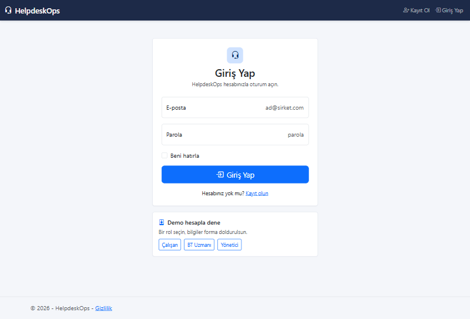

Her kullanıcının tek bir rolü vardır. Rol, kullanıcının hangi menüleri ve işlemleri göreceğini belirler:

| Rol | Yapabildikleri |
|---|---|
| Çalışan (Employee) | Kendin Çöz sayfasını kullanır, kendi taleplerini açar ve takip eder, kendine zimmetli cihazları ve zimmet formlarını görür. |
| Yönetici (Manager) | Tüm talepleri geçmişleri ve yorumlarıyla okur, Pano ve Raporlar sayfalarını görür. Hiçbir kaydı değiştiremez. |
| BT Personeli (ITAdmin) | Cihazları ve talepleri yönetir, talepleri atar ve kapatır, kullanıcı rollerini değiştirir, pano ve raporlara erişir. |

Geliştirme ortamında ve demo sitesinde hazır demo hesapları bulunur; hesaplar ve parola için README.tr.md dosyasındaki **Demo Hesaplar** bölümüne bakınız. Herkese açık demo sitesi salt okunurdur: tüm ekranlar gezilebilir ama hiçbir değişiklik kaydedilmez ve kayıt olunamaz.

## 2. Ana Sayfa ve Menü

Ana Sayfa, kullanıcıyı adıyla karşılar ve rolüne göre canlı sayılar içeren kısayol kutucukları gösterir:

- **Herkes için**: Yeni Talep, Taleplerim (açık ve işlemdeki talepler), Cihazlarım, imza bekleyen zimmet formu varsa **İmza Bekleyen Formlar** ve Kendin Çöz.
- **BT İşleri** (BT personeli ve yöneticiler): Bana Atanan, Atanmamış Talepler, Hedef Süresi Aşan, Tüm Aktif Talepler, İade Bekleyen Cihazlar ve Garantisi Bitecekler (BT personeli), Pano ve Raporlar. Bekleyen iş olan kutucuklar sarı ya da kırmızı görünür.

Aynı bölümler üst menüde ikonlarıyla yer alır; bulunulan bölüm vurgulanır. Sağ üstteki zil ikonu okunmamış bildirim sayısını gösterir (bkz. [Bildirimler](#7-bildirimler)); kişi ikonundaki menüden oturum kapatılır.

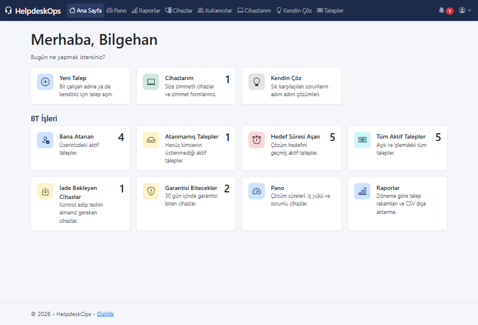

## 3. Cihaz Yönetimi

Cihaz yönetimi yalnızca **BT Personeli** rolüne açıktır.

### 3.1 Cihazları Listeleme

**Cihazlar** menüsü, kayıtlı tüm cihazları cihaz adı, IP adresi, seri numarası, tür, durum, garanti bitişi ve zimmetli kullanıcıyla listeler.

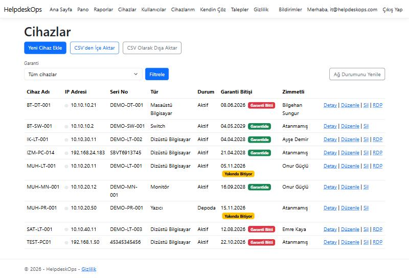

- IP adresinin solundaki nokta cihazın ağ durumunu gösterir: yeşil nokta cihazın ping'e yanıt verdiğini, kırmızı nokta yanıt vermediğini belirtir. **Ağ Durumunu Yenile** düğmesi kontrolü tekrarlar.
- Garanti sütunundaki rozetler garantinin durumunu gösterir: **Garantide**, **Yakında Bitiyor** (30 gün içinde) ve **Garanti Bitti**. Üstteki **Garanti** filtresiyle yalnızca garantisi yakında bitecek ya da bitmiş cihazlar listelenebilir.
- Dizüstü ve masaüstü bilgisayarların satırındaki **RDP** bağlantısı, Uzak Masaüstü Bağlantısı ile açılan bir `.rdp` dosyası indirir.
- Liste sayfa başına 25 cihaz gösterir; sayfa düğmeleri seçili filtreyi korur.
- Çalışanların iade talebi gönderdiği cihazlar listenin üstündeki sarı kutuda sıralanır; cihaz adına tıklamak teslim alma ekranını açar (bkz. [3.5 Geri Gelen Cihazı Teslim Alma](#35-geri-gelen-cihazı-teslim-alma)).

### 3.2 Yeni Cihaz Ekleme

Cihazlar sayfasındaki **Yeni Cihaz Ekle** düğmesi, cihaz kayıt formunu açar.

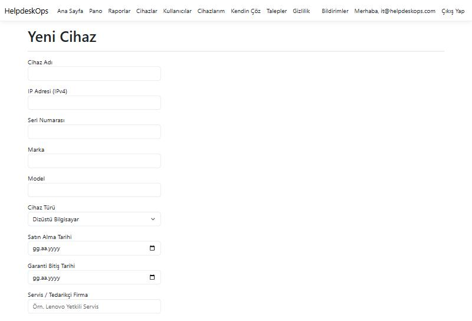

| Alan | Açıklama |
|---|---|
| Cihaz Adı | Cihazın ağdaki adı (hostname). Zorunludur. |
| IP Adresi (IPv4) | Geçerli bir IPv4 adresi olmalıdır. Zorunludur. |
| Seri Numarası | Üretici seri numarası. Zorunludur. |
| Marka / Model | Cihazın markası ve modeli. |
| Cihaz Türü | Dizüstü, masaüstü, yazıcı, switch, router, monitör veya diğer. |
| Satın Alma Tarihi / Garanti Bitiş Tarihi | Garanti takibinde kullanılır. Satın alma tarihi ileri bir tarih, garanti bitişi de satın alma tarihinden önce olamaz. |
| Servis / Tedarikçi | Garanti ve onarım için firma adı, telefon ve e-posta. |
| Cihaz Durumu | Aktif, Depoda, Arızalı veya Hizmet Dışı. |
| Zimmetli Kullanıcı | Cihazın verildiği kişi. Seçilirse zimmet kaydı ve zimmet formu otomatik oluşturulur. |
| Switch / Port / VLAN | Cihazın bağlı olduğu Cisco switch, port (örn. `Gi1/0/12`) ve VLAN. Bir porta yalnızca bir cihaz bağlanabilir. |

Oluşturulma ve güncellenme tarihleri sistem tarafından atanır.

### 3.3 Cihaz Ayrıntıları

Listedeki **Detay** bağlantısı cihazın tüm bilgilerini, garanti ve servis bilgilerini, bağlı olduğu switch portunu gösterir.

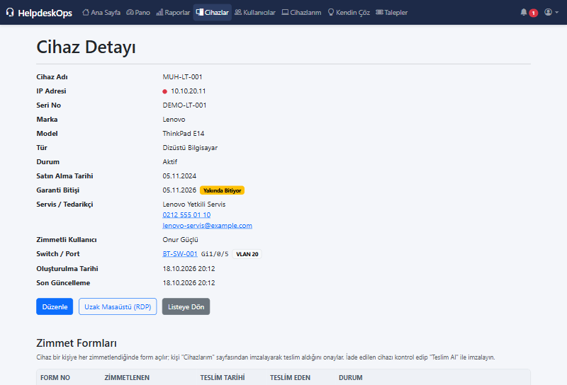

Sayfanın alt bölümlerinde şunlar bulunur:

- **Port Tablosu** (yalnızca switch'lerde): switch'in hangi portuna hangi cihazın bağlı olduğu.
- **Zimmet Formları**: cihaz her zimmetlendiğinde açılan formlar, durumları (onay bekliyor, teslim alındı, iade bekliyor, iade edildi), açık formlar için **Teslim Al** düğmesi ve **PDF İndir** bağlantısı. PDF'te teslim bilgileri ve çalışanın imzası, iade edilmiş formlarda ikinci sayfada iade bilgileri ve iki tarafın iade imzaları yer alır.
- **Cihaz Geçmişi**: format, donanım yükseltme, parça değişimi ve onarım kayıtları ile otomatik tutulan zimmet, durum ve port değişiklikleri. BT personeli bu bölümdeki formdan elle kayıt ekleyebilir.

### 3.4 CSV ile İçe ve Dışa Aktarma

Cihazlar sayfasındaki **CSV'den İçe Aktar** düğmesi, birden çok cihazı tek seferde eklemeyi sağlar.

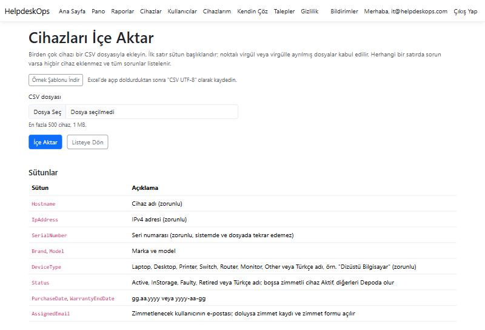

1. **Örnek Şablonu İndir** ile şablonu indirin ve Excel'de doldurun.
2. Dosyayı "CSV UTF-8" olarak kaydedip seçin ve **İçe Aktar**'a basın.
3. Herhangi bir satırda sorun varsa hiçbir cihaz eklenmez; sorunlar satır numaralarıyla listelenir. Düzeltip dosyayı yeniden yükleyin.

Tek seferde en fazla 500 cihaz eklenebilir. Zimmetli olarak içe aktarılan cihazlar için zimmet kaydı ve zimmet formu otomatik oluşturulur. **CSV Olarak Dışa Aktar** düğmesi tüm cihazları aynı biçimde indirir.

### 3.5 Geri Gelen Cihazı Teslim Alma

Çalışan "Cihazlarım" sayfasından iade talebi gönderdiğinde tüm BT personeline bildirim gider. Cihaz BT'ye getirildiğinde **Teslim Al** ekranında çalışanın iade sebebi, açıklaması ve imzası görülür.

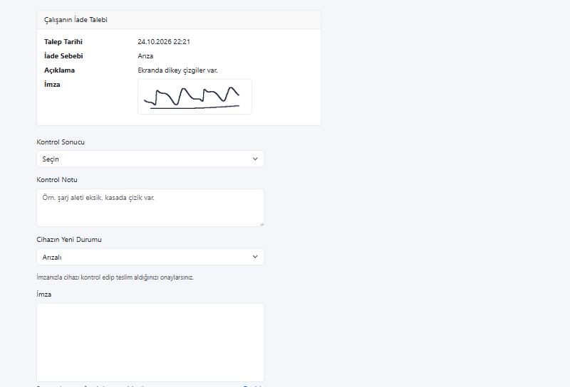

1. Cihazı fiziksel olarak kontrol edip **Kontrol Sonucu**'nu seçin: Sağlam, Hasarlı veya Eksik parça / aksesuar.
2. Gerekirse **Kontrol Notu** yazın (örn. "şarj aleti eksik").
3. **Cihazın Yeni Durumu**'nu seçin: Depoda, Arızalı veya Hizmet Dışı.
4. İmza alanına imzanızı atıp **İmzala ve Teslim Al**'a basın.

Zimmet formu kapanır, cihaz çalışanın üzerinden düşer, cihaz geçmişine iade ve kontrol sonucu yazılır ve çalışana bildirim gider. Çalışan iade talebi göndermeden cihazı elden getirdiyse (örneğin işten ayrılışta) teslim alma yine aynı ekrandan yapılabilir.

### 3.6 QR Etiketleri

Her cihaz için QR kodlu bir etiket basılabilir. Cihazlar sayfasındaki **QR Etiketleri Yazdır** düğmesi kullanımdaki tüm cihazların, cihaz ayrıntılarındaki **QR Etiketi** düğmesi yalnızca o cihazın etiketini açar. Sayfa A4 boyutunda 21'li (63,5 x 38,1 mm) etiket kâğıdına göre hazırlanmıştır; yazdırırken ölçeklendirmeyi kapatın (%100).

Etiket telefonla okutulduğunda giriş yapılması istenir, ardından:

- **Çalışan**, o cihaz için yeni talep formuna gelir. Kategori cihaz türüne göre seçilir (yazıcıda Yazıcı, switch ve router'da Ağ, diğerlerinde Donanım). Cihaz kendisine zimmetliyse formda seçili gelir; ortak yazıcı gibi başka bir cihazsa cihaz adı ve seri numarası açıklamaya yazılır.
- **BT personeli** doğrudan cihaz ayrıntılarına gider.

### 3.7 Otomatik Envanter

Şirket bilgisayarlarında çalışan envanter betiği (`scripts/Send-Inventory.ps1`) seri numarası, marka/model, işlemci, RAM, disk, Windows sürümü ve IP adresini HelpdeskOps'a gönderir. Kurulumu BT yapar (bkz. [Kurulum Rehberi, bölüm 4.4](INSTALL_TR.md#44-otomatik-envanter)).

- Kayıtlı bir bilgisayar seri numarasıyla bulunur; cihaz adı, IP adresi ve donanım bilgileri güncellenir. Elle girilen marka ve model değiştirilmez.
- Kayıtlı olmayan bir bilgisayar **Aktif** durumda yeni cihaz olarak eklenir.
- Cihaz ayrıntılarındaki **Donanım** satırı işlemciyi, RAM'i, diski, Windows sürümünü ve betiğin son rapor zamanını gösterir.
- Donanım ya da adres değiştiğinde değişiklik denetim kaydına yazılır; aynı bilgilerle gelen günlük raporlar kayıt oluşturmaz.
- 14 günden uzun süredir rapor göndermeyen cihazların ayrıntılarında sarı bir uyarı görünür.
- Cihazlar sayfasındaki **Envanter** filtresi, raporu kesilen cihazları ve betiğin henüz çalışmadığı (hiç rapor göndermeyen) bilgisayarları listeler.

### 3.8 Yazılım Lisansları

Menüdeki **Lisanslar** sayfası (yalnızca BT) şirketin satın aldığı lisansları, kaç kişinin kullandığını ve yenileme tarihlerini listeler. Yenilemesi 30 gün içinde olan lisanslar sarı, süresi dolanlar kırmızı rozetle görünür; üstteki düğmeler bu ikisini süzer.

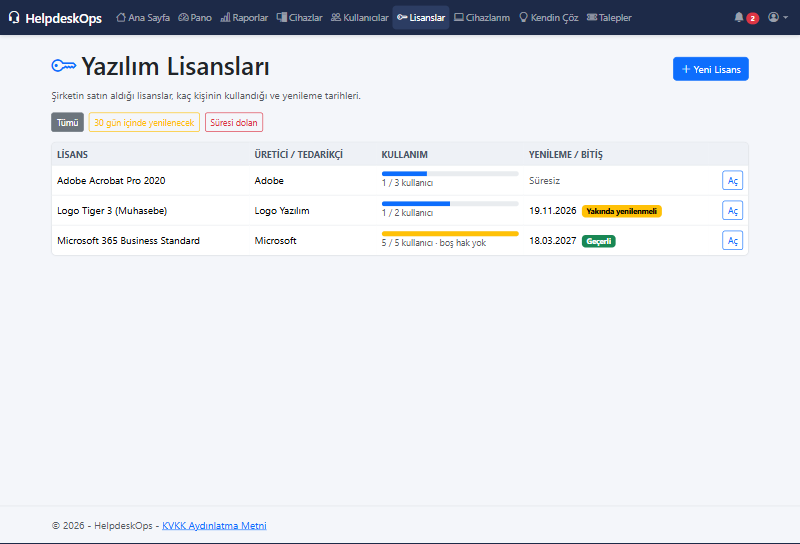

- **Yeni Lisans** ile ad, üretici/tedarikçi, kullanıcı sayısı, yenileme tarihi (süresiz lisansta boş) ve not girilir. Lisans anahtarları güvenlik gereği HelpdeskOps'ta tutulmaz; şifre kasasında saklayın.
- Lisansın sayfasında kişi seçilip **Lisans Ata** ile bir kullanıcı hakkı verilir, **Geri Al** ile alınır. Boş hak kalmayınca atama alanı gizlenir. Kullanıcı sayısı, lisansı kullanan kişi sayısının altına düşürülemez.
- İşten çıkış listesinde **Lisanslar geri alındı** otomatik bir kontroldür: kişiye atanmış lisans kaldıkça liste tamamlanamaz. Listedeki bağlantı, yalnızca o kişinin lisanslarını gösterir.

### 3.9 Sarf Malzemeleri

Menüdeki **Sarf** sayfası (yalnızca BT) toner, kartuş, tambur ve kağıt stoğunu listeler. Stoğu **En Az Stok** seviyesine inen malzemeler sarı, tükenenler kırmızı rozetle görünür; **Sipariş zamanı gelenler** düğmesi yalnızca bunları gösterir.

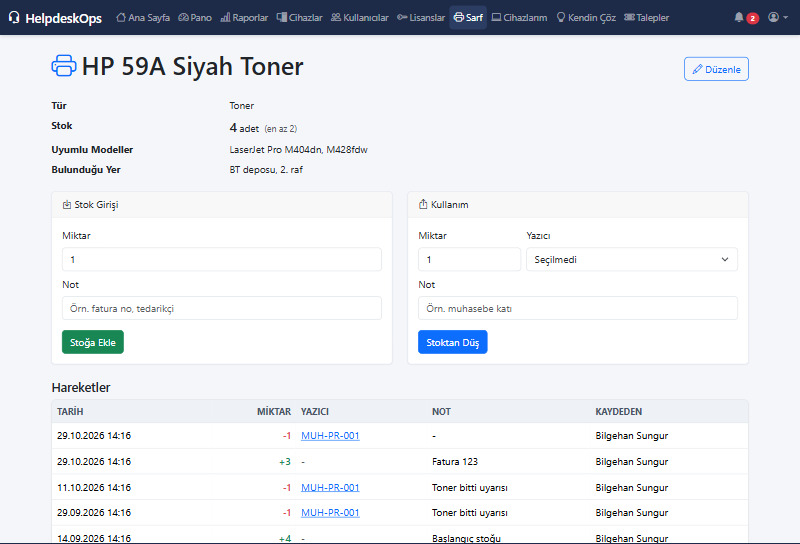

- **Yeni Sarf Malzemesi** ile ad, tür, uyumlu yazıcı modelleri, en az stok, yer ve başlangıç stoğu girilir.
- Stok elle yazılmaz; yalnızca malzemenin sayfasındaki iki formla değişir. **Stok Girişi** gelen kutuları (fatura notuyla), **Kullanım** ise stoktan düşülenleri kaydeder; kullanımda yazıcı seçilirse hareket o yazıcıya bağlanır.
- Stok hiçbir zaman eksiye düşmez. İki kişi aynı anda son toneri düşmeye çalışırsa biri "tekrar deneyin" uyarısı alır.
- **Hareketler** tablosu son 50 giriş ve kullanımı tarih, yazıcı, not ve kaydeden kişiyle gösterir. Yazıcı silinse bile geçmiş kalır.

## 4. Kendin Çöz

Çalışanlar talep açmadan önce **Kendin Çöz** sayfasında sık karşılaşılan sorunların çözümlerini dener. Konu kartlarından biri seçildiğinde o konudaki çözümler adım adım listelenir.

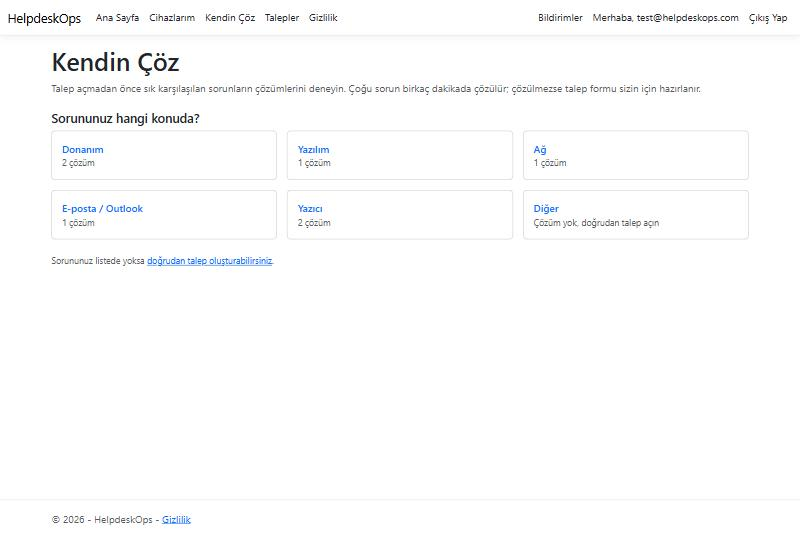

- **Sorunum çözüldü** düğmesi çözümün işe yaradığını kaydeder.
- **Çözülmedi, talep aç** düğmesi talep formunu kategori, başlık ve denenen çözüm bilgisi doldurulmuş olarak açar.

BT personeli **Kendin Çöz → Çözümleri Yönet** ekranından çözüm makalelerini ekler, düzenler, yayından kaldırır ve her makalenin self-servis başarı oranını görür.

## 5. Destek Talebi Yönetimi

### 5.1 Talepleri Listeleme

**Talepler** menüsü talepleri başlık, kategori, öncelik, durum, hedef süre, oluşturulma tarihi, cihaz, talep eden ve atanan kişi bilgileriyle listeler. Çalışanlar yalnızca kendi taleplerini, BT personeli ve yöneticiler tüm talepleri görür.

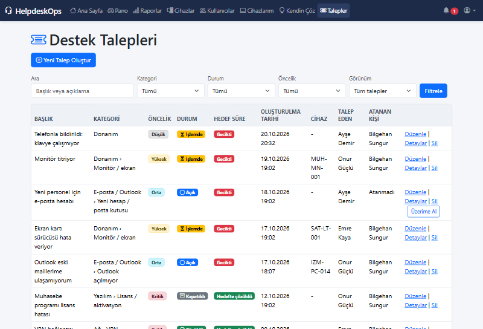

- Öncelik (Kritik kırmızıdan Düşük griye) ve durum (Açık, İşlemde, Çözüldü, Kapatıldı) renkli rozetlerle gösterilir.
- Üstteki filtrelerle başlık veya açıklamada arama yapılabilir; kategori, durum ve önceliğe göre süzülebilir.
- **Görünüm** listesi aktif talepleri, çözülen/kapatılan talepleri, hedef süresi geçenleri, BT personeline atananları ve atanmamış talepleri ayırır.
- **Hedef Süre** sütunu önceliğe göre belirlenen çözüm hedefine göre talebin durumunu gösterir: **Zamanında**, **Süre doluyor**, **Gecikti**, **Hedefte çözüldü**, **Geç çözüldü**. Kritik talepler 4 saati 7/24 sayar; yüksek (8), orta (24) ve düşük (72) öncelikli talepler yalnızca mesai saatini sayar, hafta sonları, resmî tatiller ve bayramlar atlanır. Mesai dışında açılan talebin süresi ilk mesai saatinde başlar. Rozetin üzerine gelince hedef tarih ve saat görünür.
- BT personeli atanmamış aktif talepleri **Üzerime Al** düğmesiyle tek tıkla üstlenir; açık talep bu sırada **İşlemde** durumuna geçer.

### 5.2 Yeni Talep Oluşturma

Çalışanlar için **Yeni Talep Oluştur** düğmesi önce Kendin Çöz sayfasına yönlendirir; oradan doğrudan talep formuna geçilebilir. BT personeli formu doğrudan açar ve telefonla ya da yüz yüze gelen talepleri **Talep Eden** alanından çalışan adına açabilir.

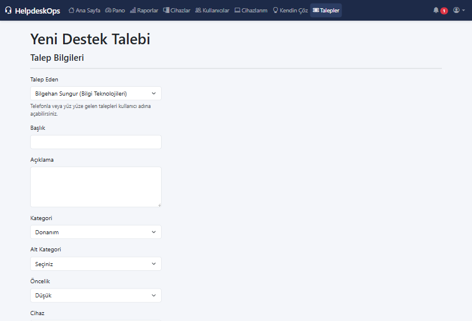

| Alan | Açıklama |
|---|---|
| Başlık / Açıklama | Sorunun kısa özeti ve ayrıntılı tanımı. Zorunludur. |
| Kategori / Alt Kategori | Örneğin Donanım › Monitör / ekran. Alt kategori listesi seçilen kategoriye göre değişir. **Diğer** seçildiğinde konuyu kısaca yazmak gerekir. |
| Öncelik | Düşük, Orta, Yüksek veya Kritik. Hedef çözüm süresini belirler. |
| Cihaz | Talebin ilgili olduğu cihaz. Çalışanlar yalnızca kendilerine zimmetli cihazları seçebilir. İsteğe bağlıdır. |
| Ekler | Ekran görüntüsü, PDF, metin/log, Word veya Excel dosyası; en fazla 5 dosya, her biri en fazla 5 MB. İsteğe bağlıdır. |

Talebin oluşturulma tarihi, durumu ve talep eden bilgisi sistem tarafından atanır.

Şirketiniz destek posta kutusunu bağladıysa talebi e-postayla da açabilirsiniz: konu başlık, metin açıklama olur, izin verilen dosya türlerindeki ekler talebe eklenir. Size talep numarasını içeren bir onay gelir. Bu e-postayı ya da talep bildirimlerini yanıtladığınızda yazdıklarınız talebe yorum olarak eklenir. E-postayla açılan talepler "Diğer" kategorisinde ve orta öncelikle başlar, BT gerekirse değiştirir.

### 5.3 Talep Ayrıntıları

Listedeki **Detaylar** bağlantısı talebin tüm bilgilerini, hedef çözüm zamanını ve atanan kişiyi gösterir.

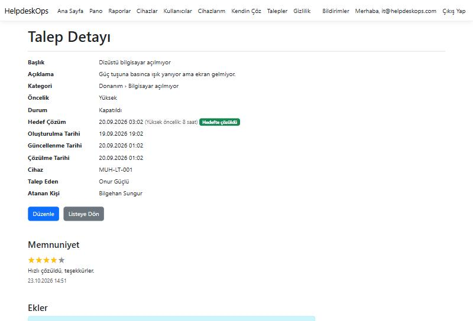

Sayfanın alt bölümlerinde şunlar bulunur:

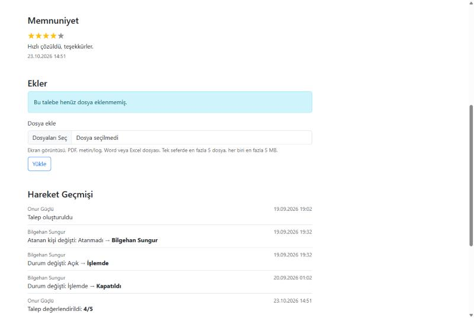

- **Memnuniyet**: talep çözüldükten veya kapatıldıktan sonra talep eden kişi talebi bir kez 1-5 arası puanlar ve isterse yorum ekler. Verilen puan herkes tarafından görülür.
- **Ekler**: talebe eklenen dosyalar. Talep eden ve BT personeli dosya yükleyebilir; herkes kendi yüklediği dosyayı, BT personeli ise tüm dosyaları silebilir. Dosyaları yalnızca talebi görebilenler indirebilir.
- **Hareket Geçmişi**: talebin oluşturulması, durum, öncelik ve atanan kişi değişiklikleri ve değerlendirme; kimin yaptığı ve ne zaman yapıldığıyla.
- **Yorumlar**: talep eden ile BT personeli arasındaki yazışma.

### 5.4 Durum Takibi

BT personeli talebi **Düzenle** ekranından günceller ve bir BT personeline atar. Kullanılabilir durumlar:

| Durum | Anlamı |
|---|---|
| Açık | Talep alındı, henüz işleme başlanmadı. |
| İşlemde | Talep üzerinde çalışılıyor. |
| Çözüldü | Sorun giderildi. |
| Kapatıldı | Talep sonlandırıldı. |

Durum **Çözüldü** ya da **Kapatıldı** olarak kaydedildiğinde **Çözülme Tarihi** otomatik yazılır. Talep **Açık** veya **İşlemde** durumuna geri alınırsa Çözülme Tarihi temizlenir. Çözüldü durumundan Kapatıldı durumuna geçişte ilk çözülme tarihi korunur.

## 6. Cihazlarım ve Zimmet Formları

**Cihazlarım** sayfası, oturum açan kullanıcıya zimmetli cihazları garanti durumlarıyla listeler.

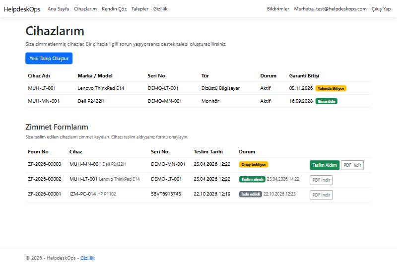

**Zimmet Formlarım** bölümünde kullanıcı adına açılmış zimmet formları yer alır:

- **İmzala**: cihazı teslim alan kullanıcı form bilgilerini ve taahhüt metnini görür, imza alanına fare ya da parmağıyla imzasını atıp **İmzala ve Teslim Aldım**'a basar.
- **İade Et**: imzalanmış bir cihazı iade etmek için sebep (işten ayrılış, cihaz değişimi, arıza, görev değişikliği, diğer) seçilir, isteğe bağlı açıklama yazılır ve imza atılır. Form **İade bekliyor** durumuna geçer ve BT personeline bildirim gider.
- **PDF İndir**: zimmet formunu imzalarıyla birlikte indirir.

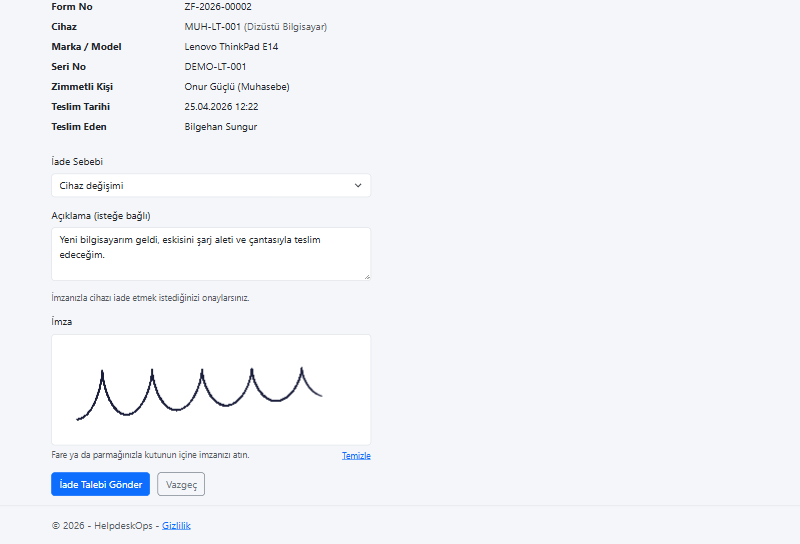

BT personeli cihazı kontrol edip teslim aldığında (bkz. [3.5 Geri Gelen Cihazı Teslim Alma](#35-geri-gelen-cihazı-teslim-alma)) form **İade edildi** olarak kapanır. Cihaz başka birine verildiğinde, depoya alındığında veya silindiğinde de form kapanır.

## 7. Bildirimler

Sağ üstteki zil ikonunun yanındaki sayı okunmamış bildirimleri gösterir. Bildirimler şu durumlarda oluşur:

- Talebinize BT ekibi yorum yazdığında veya talebinizin durumu değiştiğinde,
- Talebiniz BT ekibi tarafından üstlenildiğinde ya da adınıza talep açıldığında,
- (BT personeli için) bir talep size atandığında, talep eden yorum yazdığında veya talebi değerlendirdiğinde,
- (BT personeli için) bir çalışan cihaz iade talebi gönderdiğinde; çalışan da cihazı teslim alındığında bildirim alır.

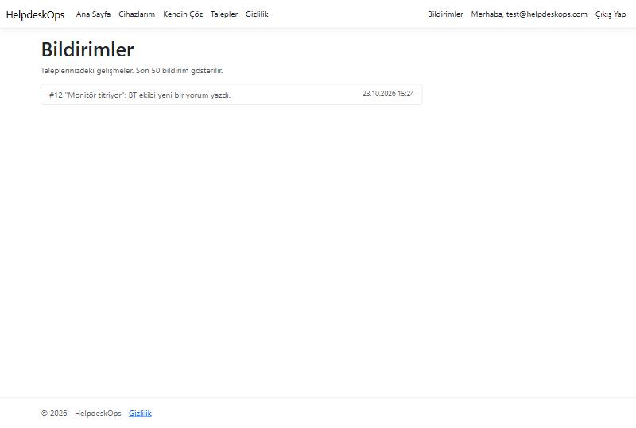

Bir bildirime tıklamak ilgili sayfayı açar ve bildirimi okunmuş sayar. E-posta gönderimi ayarlanmışsa her bildirim, ilgili sayfaya giden bir bağlantıyla birlikte e-postayla da gönderilir. **Tümünü Okundu İşaretle** düğmesi tüm bildirimleri okunmuş yapar.

## 8. Pano

**Pano**, BT personeli ve yöneticilere taleplerin ve cihazların genel durumunu tek sayfada gösterir.

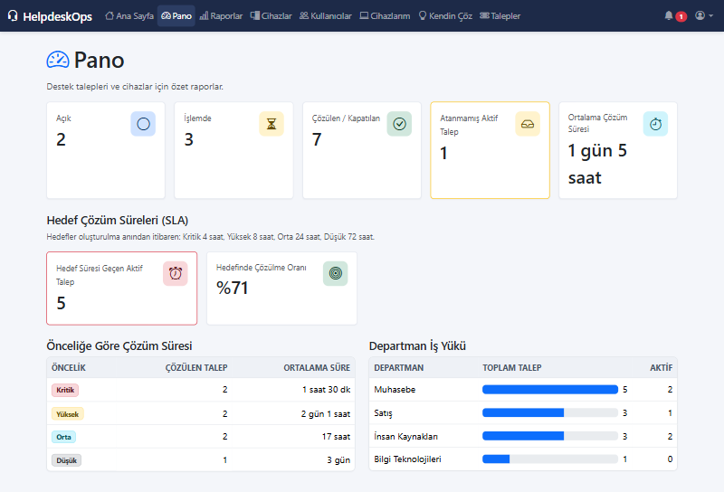

- **Özet kartları**: ikonlu kartlarda açık, işlemde, çözülen/kapatılan ve atanmamış aktif talep sayıları ile ortalama çözüm süresi. Kartlara tıklamak ilgili filtreli talep listesini açar.
- **Hedef Çözüm Süreleri (SLA)**: hedef süresi geçen aktif talepler ve hedefinde çözülen taleplerin oranı.
- **Önceliğe Göre Çözüm Süresi** ve **Departman İş Yükü** tabloları.
- **Kronik Sorunlu Cihazlar**: en çok talep alan marka ve modeller.
- **Cihaz Garantileri**: 30 gün içinde garantisi bitecek ve garantisi bitmiş cihaz sayıları. BT personeli için kartlar filtreli cihaz listesini açar.

## 9. Raporlar

**Raporlar** sayfası seçilen döneme (son 7, 30, 90 gün veya 1 yıl) ait rakamları gösterir. BT personeli ve yöneticiler erişebilir.

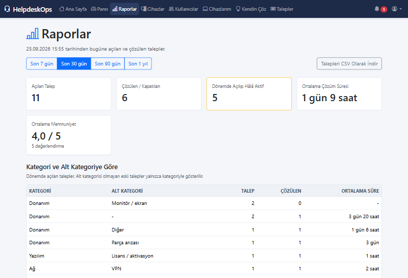

- Dönemde açılan, çözülen ve hâlâ aktif olan talepler, ortalama çözüm süresi ve ortalama memnuniyet puanı.
- Kategori ve alt kategoriye göre talep sayıları ve ortalama çözüm süreleri.
- BT personeli performansı: her personelin üzerindeki aktif talepler, dönemde çözdüğü talepler, ortalama çözüm süresi ve ortalama memnuniyet puanı.
- **Talepleri CSV Olarak İndir** düğmesi dönemin taleplerini Excel'de açılabilen bir dosya olarak indirir.

## 10. Kullanıcılar

**Kullanıcılar** sayfası yalnızca BT personeline açıktır. Kayıtlı kullanıcıları e-posta, departman, rol, zimmetli cihaz sayısı ve üzerlerindeki aktif taleplerle listeler; ad, e-posta veya departmana göre aranabilir ve role göre süzülebilir.

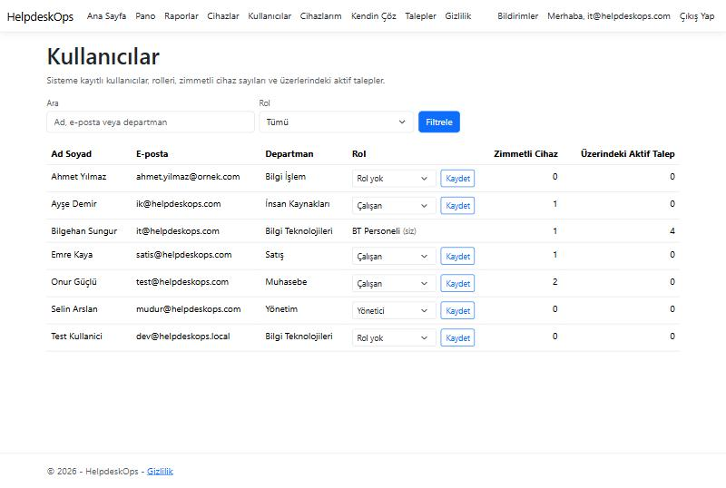

Bir kullanıcının rolü, satırındaki listeden yeni rol seçilip **Kaydet** düğmesine basılarak değiştirilir:

- Kimse kendi rolünü değiştiremez; satırında "(siz)" yazar.
- BT personeli rolünden çıkarılan kişinin aktif talepleri atanmamış taleplere alınır ve her talebin geçmişine kaydedilir.
- Rol değişikliği, kullanıcının açık oturumunda en geç bir dakika içinde geçerli olur.

**İşlemler** sütunundaki düğmeler kişi için işe giriş veya işten çıkış listesi açar (bkz. [10.1 İşe Giriş ve İşten Çıkış](#101-işe-giriş-ve-işten-çıkış)), kişinin verilerini indirir ve ayrılan çalışanı anonimleştirir (bkz. [13. KVKK ve Kişisel Veriler](#13-kvkk-ve-kişisel-veriler)).

Üst üste 5 kez hatalı şifre giren kullanıcının hesabı 15 dakikalığına kilitlenir ve listede **Kilitli** rozetiyle görünür. Telefonla arayan bir çalışan için **Kilidi aç** bağlantısı kilidi hemen kaldırır. İki adımlı doğrulamayı açmış kullanıcıların adının yanında **2FA** rozeti görünür.

Şirket dizini bağlıysa dizinden gelen kullanıcılarda **Dizin** rozeti görünür ve sayfanın üstünde **Dizinle Eşitle** düğmesi çıkar. Eşitleme her gün kendiliğinden de çalışır: yeni kişiler Çalışan rolüyle eklenir, ad, e-posta ve departman güncellenir, dizinde kapatılan ya da silinen kişinin hesabı kapanır. Rolleri yine bu sayfadan siz verirsiniz. Dizinde yeniden açılan bir hesap burada kendiliğinden açılmaz; **Yeniden aç** bağlantısını kullanın.

### 10.1 İşe Giriş ve İşten Çıkış

Kullanıcılar sayfasındaki **İşe Giriş / İşten Çıkış** düğmesi, yeni gelen ve ayrılan çalışanlar için açılan kontrol listelerini gösterir. Liste varsayılan olarak açık süreçleri hedef tarihe göre sıralar; tamamlananlar ve süreç türü filtreden seçilir. Hedef tarihi geçen açık listelerde **Tarihi geçti** rozeti görünür.

Liste, kullanıcı satırındaki kişi ekleme veya çıkarma simgesiyle ya da sayfanın üstündeki düğmelerle açılır. Kişi, hedef tarih (işe başlama veya son çalışma günü) ve isteğe bağlı bir not girilir. Liste, şirketlerde en sık yapılan adımlarla (Active Directory hesabı, e-posta, programlar, paylaşılan klasörler, kartlı geçiş) hazır gelir. Aynı kişi için aynı türde ikinci bir açık liste açılamaz, kimse kendisi için işten çıkış listesi açamaz.

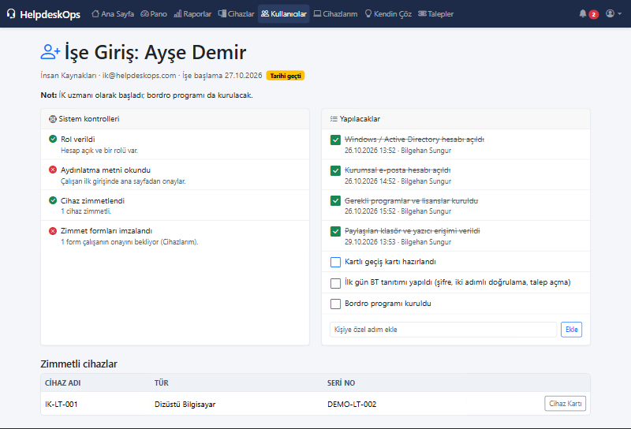

Liste sayfasının iki bölümü vardır:

- **Sistem kontrolleri**: HelpdeskOps'un kendisinin bildiği adımlar. İşe girişte kişinin rolü olup olmadığı, KVKK aydınlatma metnini onaylayıp onaylamadığı, en az bir cihaz zimmetlenip zimmetlenmediği ve zimmet formlarını imzalayıp imzalamadığı; işten çıkışta üzerinde cihaz, açık zimmet formu, aktif talep ve yazılım lisansı kalıp kalmadığı kontrol edilir. Bu süreçte imzalı teslim alma olmadan geri alınan cihazlar sarı uyarıyla gösterilir ama listeyi tamamlamayı engellemez.
- **Yapılacaklar**: BT'nin elle işaretlediği adımlar. Her adımın yanında kimin ne zaman işaretlediği görünür. Alttaki alandan kişiye özel adım eklenebilir (ör. "Bordro programı kuruldu").

Altta kişinin zimmetli cihazları ve zimmet formları listelenir. İşten çıkışta **Geri Al** cihazın düzenleme sayfasını, **Teslim Al** imzalı teslim alma sayfasını açar.

Tüm zorunlu kontroller geçip bütün adımlar işaretlenince **Tamamla** düğmesi açılır. İşten çıkış listesi tamamlanınca kişinin hesabı kapanır: giriş yapamaz, açık oturumları kapanır ve kullanıcı listesinde **Hesap kapalı** rozetiyle görünür. Geri dönen bir çalışan için **Yeniden aç** bağlantısı hesabı tekrar açar. Tamamlanan işten çıkış listesinden KVKK anonimleştirme sayfasına geçilebilir. Yanlışlıkla açılan listeler silinebilir; tamamlanan listeler kayıt olarak kalır ve tüm değişiklikler denetim kaydına yazılır.

## 11. Hesabım ve Güvenlik

Sağ üstteki kişi ikonundan **Hesabım** sayfası açılır (salt okunur demo sitesinde kapalıdır):

- **Profil**: e-posta ve telefon bilgisi.
- **Şifre**: mevcut şifreyle yeni şifre belirlenir. Şifre en az 10 karakter olmalı; büyük harf, küçük harf, rakam ve özel karakter içermelidir. Şirket dizinine bağlı hesaplarda bu sayfa görünmez, şifre dizinde değiştirilir.
- **İki Adımlı Doğrulama**: girişte şifrenin yanında telefondaki doğrulama uygulamasının ürettiği 6 haneli kod da istenir.
- **Kişisel Verilerim**: sizinle ilgili tutulan verileri indirme (bkz. [13.2](#132-kişisel-verilerim)).

Şirket Microsoft hesabı kullanıyorsa giriş sayfasındaki **Microsoft ile Giriş Yap** düğmesine basın. Active Directory kullanıyorsa e-postanızı ve Windows şifrenizi giriş formuna yazın.

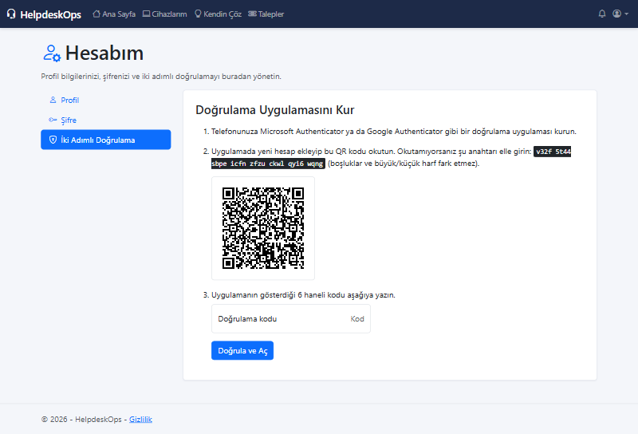

İki adımlı doğrulamayı açmak için:

1. **Doğrulama uygulaması ekle** düğmesine basın.
2. Microsoft Authenticator ya da Google Authenticator ile ekrandaki QR kodu okutun (ya da anahtarı elle girin).
3. Uygulamanın gösterdiği kodu yazıp **Doğrula ve Aç**'a basın.
4. Gösterilen 10 kurtarma kodunu güvenli bir yere kaydedin. Telefonunuzu kaybederseniz giriş sayfasındaki **Kurtarma koduyla girin** bağlantısıyla bu kodlardan birini kullanabilirsiniz; her kod bir kez geçerlidir.

Bu sayfadan kurtarma kodları yenilenebilir, uygulama anahtarı sıfırlanabilir ya da iki adımlı doğrulama kapatılabilir.

## 12. Denetim Kaydı

**Denetim Kaydı** yalnızca BT personeline açıktır ve kişi ikonundaki menüden açılır. Cihaz, talep, zimmet formu, çözüm makalesi, talep eki, kullanıcı ve rol değişikliklerinin her biri otomatik kaydedilir; kayıtlar elle değiştirilemez. Yalnızca KVKK işlemleri (anonimleştirme ve saklama süreleri) kayıtlardaki kişisel bilgileri temizler.

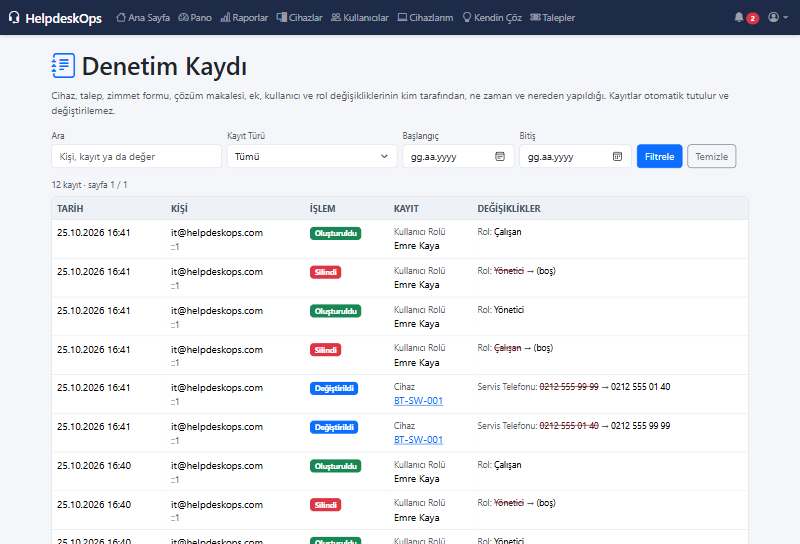

- Her satırda tarih, değişikliği yapan kişi ve IP adresi, işlem (Oluşturuldu, Değiştirildi, Silindi), kayıt ve değişen alanların eski ve yeni değerleri görünür. Kişiler kimlik numarasıyla değil adlarıyla yazılır.
- Şifre değişiklikleri yalnızca "değiştirildi" olarak görünür; şifrenin kendisi ya da hash'i hiçbir zaman kaydedilmez.
- Arama kutusu kişi, kayıt adı ve değerlerde arar; kayıt türü ve tarih aralığıyla süzülebilir. Liste sayfa başına 50 kayıt gösterir.
- Cihaz ve talep ayrıntı sayfalarındaki **Denetim Kaydı** düğmesi yalnızca o kaydın geçmişini açar.
- KVKK kapsamında yapılan veri indirmeleri **Dışa Aktarıldı** işlemiyle, günlük saklama süresi temizliği **Saklama Süresi** kayıt türüyle görünür.

## 13. KVKK ve Kişisel Veriler

HelpdeskOps, 6698 sayılı Kişisel Verilerin Korunması Kanunu (KVKK) için dört araç sunar: aydınlatma metni, kişinin kendi verilerini indirmesi, ayrılan çalışanın anonimleştirilmesi ve saklama sürelerinin otomatik uygulanması.

### 13.1 Aydınlatma Metni

Sayfanın altındaki ve giriş sayfasındaki **KVKK Aydınlatma Metni** bağlantısı, giriş yapmadan da okunabilen metni açar. Metin veri sorumlusunu, işlenen verileri, amaçları, hukuki sebepleri, aktarımı, saklama sürelerini ve KVKK'nın 11. maddesindeki hakları anlatır.

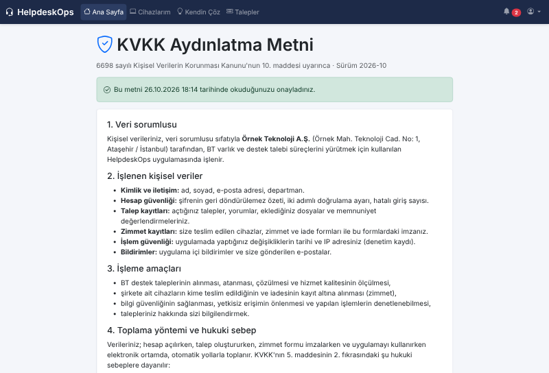

- Giriş yapan kullanıcı metnin güncel sürümünü onaylayana kadar sayfaların üstünde mavi bir uyarı görür. **Okudum, anladım** düğmesi onay tarihini kaydeder; bu kayıt, şirketin aydınlatma yükümlülüğünü yerine getirdiğinin kanıtıdır.
- Kayıt formu metne bağlantı verir; kayıt olan kişinin onayı otomatik kaydedilir.
- Şirket adı, adresi, başvuru e-postası ve metin sürümü `appsettings.json` içindeki `Kvkk` bölümünden değiştirilir. Sürüm yükseltildiğinde herkesten metni yeniden onaylaması istenir.

### 13.2 Kişisel Verilerim

**Hesabım → Kişisel Verilerim** sayfasındaki **Verilerimi İndir (JSON)** düğmesi, sizinle ilgili tutulan her şeyi tek bir dosyada indirir: hesap bilgileri, açtığınız ve size atanan talepler, yorumlarınız, yüklediğiniz dosyaların listesi, zimmetli cihazlarınız, zimmet formlarınız, bildirimleriniz ve denetim kaydındaki işlemleriniz. Şifre özeti, doğrulama anahtarı ve imza görüntüleri dosyaya konmaz.

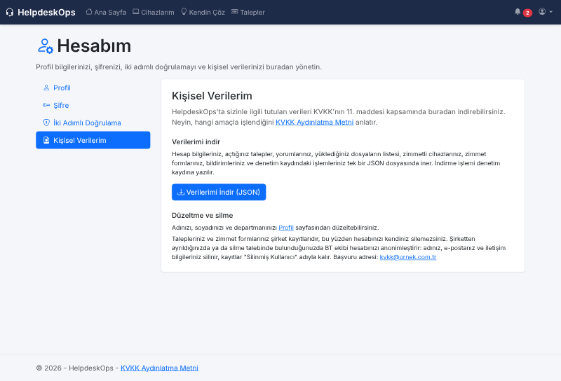

Talepler ve zimmet formları şirket kayıtları olduğu için kullanıcı hesabını kendisi silemez. Silme talepleri BT ekibine iletilir.

### 13.3 Kullanıcıyı Anonimleştirme (BT)

Şirketten ayrılan ya da silme talebinde bulunan bir çalışan için BT personeli, **Kullanıcılar** sayfasındaki KVKK sütunundan iki işlem yapabilir:

- **İndirme düğmesi**: kişinin verilerini, kendisinin indirebildiği dosyayla aynı biçimde indirir. Başvuruya cevap verirken kullanılır.
- **Anonimleştir düğmesi**: onay sayfasını açar. Sayfa nelerin silineceğini ve nelerin kalacağını listeler.

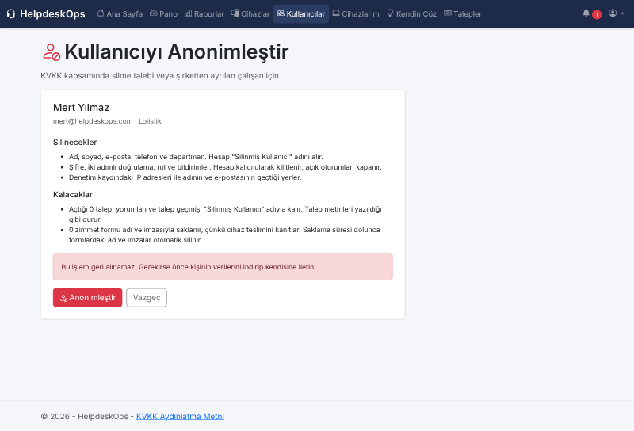

Anonimleştirme geri alınamaz:

- Ad, soyad, e-posta, telefon ve departman silinir. Hesap "Silinmiş Kullanıcı" adını alır, kalıcı olarak kilitlenir ve açık oturumları kapanır. Rolleri, iki adımlı doğrulaması ve bildirimleri silinir.
- Talepler, yorumlar ve talep geçmişi "Silinmiş Kullanıcı" adıyla kalır. Denetim kaydındaki IP adresleri ile kişinin adının ve e-postasının geçtiği yerler temizlenir.
- Zimmet formları cihaz teslimini kanıtladıkları için adı ve imzasıyla saklanır; saklama süresi dolunca bu bilgiler otomatik silinir.
- Kişinin üzerinde cihaz, iade edilmemiş zimmet formu ya da aktif talep varsa işlem yapılmaz; sayfa önce ne yapılması gerektiğini söyler. Kimse kendi hesabını anonimleştiremez.
- Anonimleştirilmiş kullanıcı listede **Anonimleştirildi** rozetiyle görünür ve cihaz atama ya da talep açma listelerinde çıkmaz.

### 13.4 Saklama Süreleri (BT)

Kişi ikonundaki menüden açılan **Saklama Süreleri** sayfası, kişisel verilerin ne kadar saklanacağını gösterir. Kurallar her gün otomatik uygulanır:

| Veri | Süre | Süre dolunca |
| --- | --- | --- |
| Bildirimler | 6 ay | Silinir |
| Talep ekleri | 2 yıl (talep çözüldükten veya kapatıldıktan sonra) | Dosyalar silinir, talep kalır |
| Denetim kaydı IP adresleri | 2 yıl | IP adresi silinir, kayıt kalır |
| Denetim kaydı | 10 yıl | Kayıt silinir |
| Zimmet formları | 10 yıl (iadeden sonra) | Ad, departman, açıklama ve imzalar silinir; cihaz bilgileri kalır |

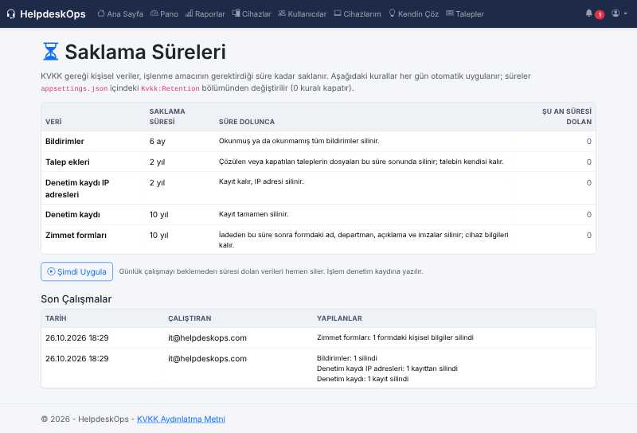

- **Şu An Süresi Dolan** sütunu, bir sonraki çalışmada silinecek kayıt sayısını gösterir. **Şimdi Uygula** düğmesi günlük çalışmayı beklemeden kuralları hemen uygular.
- **Son Çalışmalar** tablosu her çalışmada neyin silindiğini gösterir; aynı bilgi denetim kaydına da yazılır.
- Süreler `appsettings.json` içindeki `Kvkk:Retention` bölümünden gün olarak değiştirilir; 0 o kuralı kapatır. Aydınlatma metnindeki tablo aynı ayarlardan oluşur.
